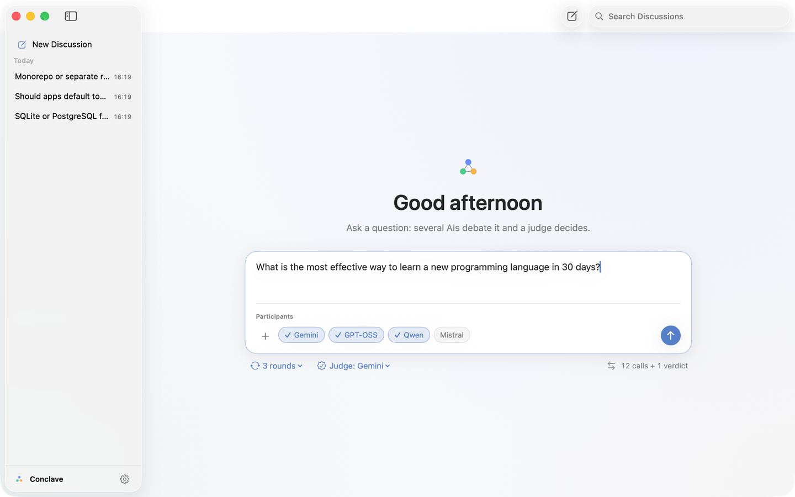
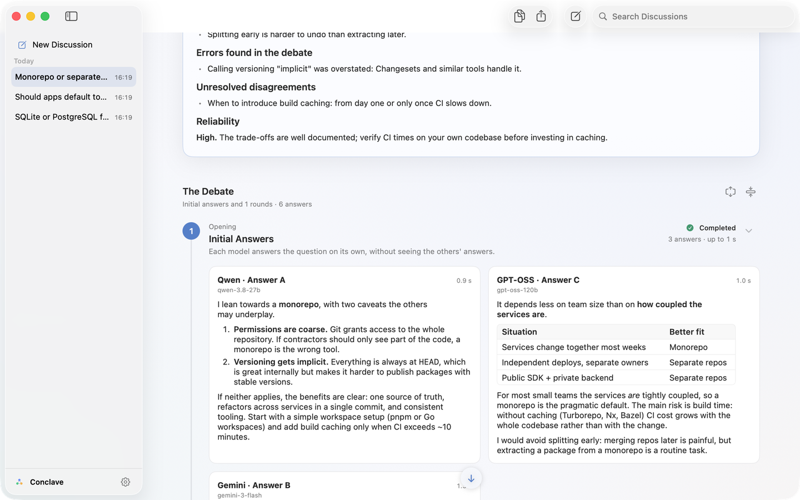

# Conclave

**An LLM council for your Mac.** Claude, Gemini, GPT-OSS, Qwen and other models debate your
question in rounds — independent answers, anonymous cross-critique, revision, final position —
and a judge writes the verdict. A native SwiftUI app, **free with free API keys** (Gemini, Groq,
OpenRouter) or with your Claude subscription.

**[⬇ Download the latest DMG](https://github.com/peppolone/Conclave/releases/latest)** · macOS 26+ · Apple Silicon and Intel

Everything runs on your Mac: the app bundles a small local engine and talks only to the model
providers you configure. No account, no server, no telemetry.

[](LICENSE)


[](https://github.com/peppolone/Conclave/actions/workflows/release.yml)




> [!NOTE]
> **Beta — work in progress.** Expect rough edges; feedback is welcome in
> [Issues](https://github.com/peppolone/Conclave/issues).

## Why a council?

A single model answers confidently even when it is wrong. In Conclave the answers are anonymous
(Answer A, B, C…), so models critique arguments rather than brands, a random member plays devil's
advocate, and the judge weighs evidence instead of counting votes. Compared with web-based
LLM-council projects, Conclave is a native Mac app with history, follow-up questions, automatic
fallbacks when a free model is slow or retired, and no server to run.

## Features

- **Debate in rounds** between up to 10 participants, with 0 to 3 rounds and a judge of your choice.
- **One voice per model family** (Gemini, GPT-OSS, Qwen, …): the engine picks the best variant that
  answers and falls back to the next one if it is slow, rate-limited or retired.
- **Retired models are replaced automatically** with the best match from the provider's catalog.
- **A verdict you can act on**: the short answer first, a reliability rating, a table of where the models
  disagree (and who changed their mind), what to double-check and why.
- **Keep chatting in the same conversation** after the verdict: a quick answer from the judge or any model,
  or call the whole council again on the new question.
- **Attachments**: PDFs, text and code files, images (text extracted on your Mac with PDFKit and Vision OCR,
  so every model can read them).
- **Web search** before the debate: Claude (with your subscription) or GPT-OSS on Groq gathers sources that
  every member then works from.
- **Fast, Standard or Deep** debates, with an estimate of calls and time.
- History searchable by question, title and verdict (case- and accent-insensitive), Markdown export.
- **Native interface** (AppKit + SwiftUI, Liquid Glass), light and dark mode, Italian and English UI.
  Models answer in the language of the question.
- **Works with free tiers** (Gemini AI Studio, Groq, OpenRouter `:free` models, Mistral, Cerebras)
  and with an existing Claude subscription through the official Claude Code CLI.

## Requirements

- macOS 26 or later, Apple Silicon or Intel (the app is a universal binary).
- At least one of:
  - an API key from an OpenAI-compatible provider (several have free tiers, see below);
  - [Claude Code](https://code.claude.com/docs/en/setup) installed and signed in (`claude`) with a
    Claude subscription.

Node.js is bundled with the app; you do not need to install it.

## Installation

1. Download `Conclave-<version>.dmg` and `SHA256SUMS.txt` from
   [Releases](https://github.com/peppolone/Conclave/releases).
2. Optionally verify the download:

   ```bash
   cd ~/Downloads && shasum -a 256 -c SHA256SUMS.txt
   ```

3. Open the DMG and drag **Conclave** to **Applications**.
4. **First launch.** Conclave is signed with a self-signed project certificate and is **not
   notarized** (there is no paid Apple Developer account behind it), so Gatekeeper blocks it the
   first time. Open the app once, then go to **System Settings ▸ Privacy & Security** and click
   **Open Anyway**. Alternatively, from Terminal:

   ```bash
   xattr -dr com.apple.quarantine /Applications/Conclave.app
   ```

   Only do this for a build you downloaded from this repository's Releases page.

### Updates

Conclave checks the GitHub Releases API at most once a week (or on demand from the app menu) and
tells you when a newer version exists. It never downloads or installs anything: it only offers to
open the release page. The check can be turned off in **Settings ▸ General**.

## Setting up providers

Open **Settings** (the app opens it automatically when no key is configured):

- **API Keys** — paste a key for each provider you want to use. Free keys:

  | Provider | Get a key | Notes |
  |---|---|---|
  | Google Gemini | [aistudio.google.com/apikey](https://aistudio.google.com/apikey) | Free tier with small daily quotas on the larger models |
  | Groq | [console.groq.com/keys](https://console.groq.com/keys) | Free tier; per-minute token limits |
  | OpenRouter | [openrouter.ai/settings/keys](https://openrouter.ai/settings/keys) | `:free` models; can be slow |
  | Mistral | [console.mistral.ai/api-keys](https://console.mistral.ai/api-keys) | "Experiment" plan |
  | Cerebras | [cloud.cerebras.ai](https://cloud.cerebras.ai) | Free tier |
  | OpenAI | [platform.openai.com/api-keys](https://platform.openai.com/api-keys) | Paid |

  Free-tier limits change often and are set by each provider. When a quota runs out, the engine
  waits briefly on rate limits and otherwise skips that participant for the round.

- **Models** — pick the voices that take part, test them, and browse each provider's catalog.

**Claude** is used through the `claude` command-line tool that you have already installed and
signed in to. Conclave runs the unmodified CLI on your Mac with tools disabled, an empty working
directory and `ANTHROPIC_API_KEY` removed from its environment (so it uses your subscription, not
API billing). Conclave never sees or stores your Claude credentials. Use of your subscription this
way is subject to [Anthropic's terms](https://code.claude.com/docs/en/legal-and-compliance) and
to your plan's usage limits.

## How a debate works

1. **Answers** — every participant answers the question independently.
2. **Cross-critique** (round 1) — each participant reads the others' answers, labelled only with
   letters (A, B, C…), and critiques them. One participant, chosen at random, plays devil's advocate.
3. **Revision** (round 2) — each participant revises its own answer in light of the critiques.
4. **Final position** (round 3) — each participant states its final answer after reading the
   revised ones. Skipped automatically if nobody changed position.
5. **Verdict** — the judge reads the final positions and the critiques and writes the verdict.
   If the chosen judge fails, the engine tries Claude and then the other participants.

A participant that fails after its first answer skips that round and rejoins the next. If only
one participant is left, the rounds are skipped and the app says so.

## Privacy and security

- **Your questions are sent to the providers you choose**, and only to them. Read their terms:
  some free tiers (for example Google AI Studio and some OpenRouter `:free` models) may use your
  prompts to improve their models.
- **No telemetry.** The only network request Conclave makes on its own is the weekly update check
  to `api.github.com`, which you can disable.
- **API keys** are stored in the macOS Keychain (generic passwords, service
  `io.github.peppolone.conclave`). The app passes them to the local engine through its standard
  input; they are never written to disk or put in environment variables, and they are masked in
  logs and error messages. Because the app is not signed with an Apple Developer Team ID, macOS
  ties the Keychain item to each build: after an update it asks once for your login password —
  choose **Always Allow**.
- **Local engine** listens only on `127.0.0.1` on a random port and rejects any request without a
  per-session token generated by the app at launch.
- **Data** lives in `~/Library/Application Support/Conclave/` (folder mode `0700`, files `0600`):
  the SQLite database of debates (`data/council.db`), `selection.json` (chosen models),
  `health.json` (cached model checks) and `server.log`. Delete the folder to remove everything;
  remove the keys with Keychain Access.

See [SECURITY.md](SECURITY.md) for the threat model and how to report a vulnerability.

## Building from source

Requirements: macOS 26, Xcode (the build uses `swiftc` and `actool` to compile the icon and asset
catalog), Node.js 24.

```bash
git clone https://github.com/peppolone/Conclave.git
cd conclave
npm ci
npm run typecheck     # TypeScript type check, must report 0 errors
npm run test:chaos    # engine stress suite with a mock provider (~2 minutes, no real keys)
npm run app           # builds dist/Conclave.app
npm run app:install   # builds and copies it to /Applications (quit the app first)
```

A local build uses the `node` found in your login shell's `PATH`. Without the project's signing
certificate, the build is signed ad-hoc. Either way macOS asks for your permission to read the
Keychain item again after each rebuild.

To work on the engine alone, `npm start` runs it on `http://localhost:4848` with data in the
project folder and keys read from `.env` (copy `.env.example`). In this mode no token is required:
it is meant for development only.

See [CONTRIBUTING.md](CONTRIBUTING.md) before opening a pull request.

## Architecture

Two parts that talk only over local HTTP (JSON API + Server-Sent Events):

- **macOS app** (`macos/`) — AppKit + SwiftUI, compiled with `swiftc` (no Xcode project). It starts
  the engine, hands it a session token and the API keys on standard input, and follows debates
  live over SSE.
- **Engine** (`src/`) — Node 24 running TypeScript directly (type stripping, no build step, no
  runtime npm dependencies). It orchestrates the rounds (`src/debate/`), calls providers through
  an OpenAI-compatible adapter or the Claude CLI (`src/adapters/`), checks model health at launch
  and stores debates in SQLite (`node:sqlite`).

## License

[MIT](LICENSE). Conclave is an independent project, not affiliated with Anthropic, Google, OpenAI
or any other model provider.
